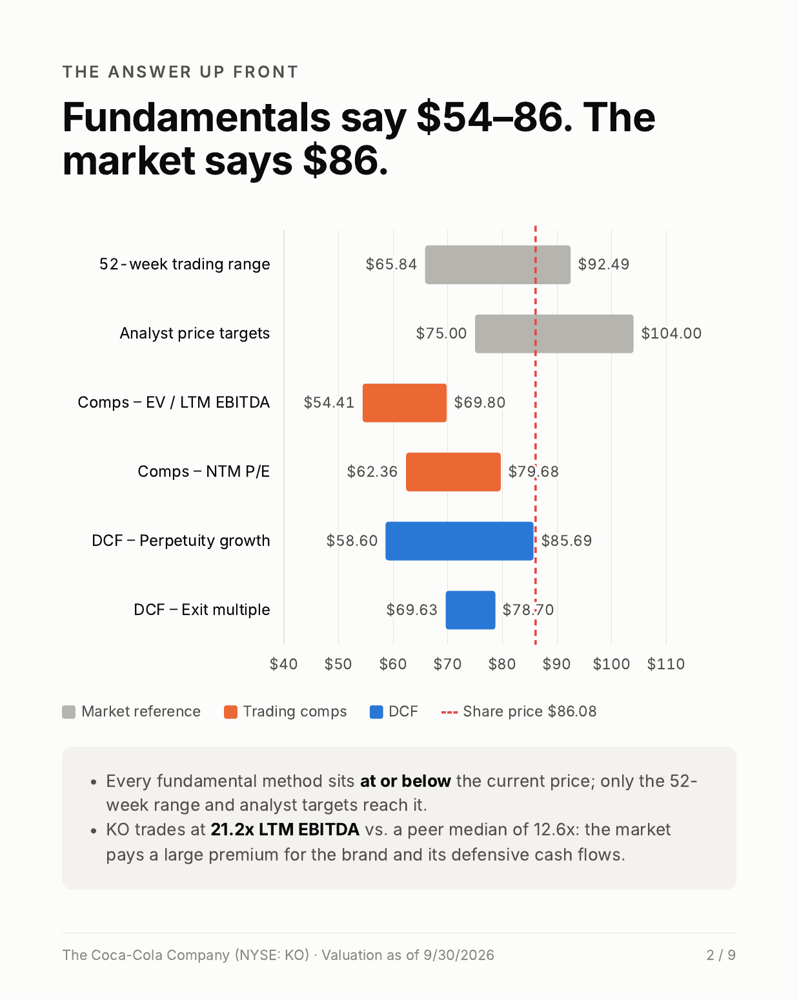

# What is Coca-Cola actually worth?

A full valuation of **The Coca-Cola Company (NYSE: KO)**, built from scratch in Excel: a discounted cash flow model, trading comparables, and a football field summary.

**Valuation date:** September 30, 2026 · **Share price:** $86.08

## Result

| Method | Implied value per share |
|---|---|
| DCF – perpetuity growth (g = 3.0%) | $69.24 |
| DCF – exit multiple (18.0x EBITDA) | $74.08 |
| Trading comps – EV / LTM EBITDA (13.0x–17.0x) | $54.41 – $69.80 |
| Trading comps – NTM P/E (18.0x–23.0x) | $62.36 – $79.68 |

On these assumptions KO screens as fully valued, 14–20% below the market price. KO trades at 21.2x LTM EBITDA versus a peer median of 12.6x. The market prices Coke as a near bond-like asset: using KO's raw regression beta (0.32) instead of the peer-based beta (0.54) lowers WACC to ~6.7% and brings the DCF value to roughly the current share price.

## Approach

**1. Projections (FY26E–FY30E).** Revenue is built as organic growth + FX + M&A, anchored to company guidance. FY27 revenue falls 3.0% (+4.5% organic, –7.5% from deconsolidating CCBA, the African bottler KO is selling a controlling stake in), while the Adj. EBIT margin rises from 31.5% to 33.5%: a mix effect, since bottling earns ~7% margins. Adj. EBIT adds back other operating charges (impairments, fairlife contingent consideration, restructuring).

**2. WACC: 7.65%.** Peer betas (PepsiCo, Keurig Dr Pepper, Monster, CCEP) are Blume-adjusted, unlevered with Hamada, and the median (0.49) is relevered at KO's capital structure (0.54). KO's own adjusted beta (0.54) is a cross-check. Cost of equity 8.0% (10Y UST 5.29%, ERP 5.0%); after-tax cost of debt 4.7%; market-value weights ~90/10.

**3. Terminal value.** Perpetuity growth at 3.0% implies 15.9x FY30E EBITDA; an 18.0x exit multiple (a premium to peers, a discount to KO's current multiple) implies 3.5% growth. Mid-year convention with a 9/30 stub period.

**4. EV to equity.** Debt, cash and NCI from the Q2'26 10-Q. KO's listed equity-method stakes (Monster, CCEP, Coca-Cola FEMSA, Coca-Cola HBC and others) are added at market value (~$45bn vs. ~$21bn book), since their income is excluded from EBITDA. CCBA sale proceeds and the retained 25% stake are included in the bridge.

**5. Trading comps.** EV built from 10-Q / half-year balance sheets; LTM Adj. EBITDA = FY25 + H1'26 – H1'25 on each company's adjusted basis. Keurig Dr Pepper is pro forma for its JDE Peet's acquisition (closed 4/1/26); KO's EBITDA excludes CCBA to keep the numerator and denominator on the same set of assets; CCEP is translated from EUR at the 9/30/26 ECB rate.

**6. Sensitivities and football field.** WACC × growth and WACC × exit multiple tables, summarized alongside comps, the 52-week range and analyst targets.

## Files

| File | Contents |
|---|---|
| `KO_DCF_Model.xlsx` | Full model: historical financials, adjustments, WACC, CCBA pro forma, equity-method investments, DCF, sensitivities, comps, football field. Input cells are blue, formulas black, cross-sheet links green; sources are in cell comments. |
| `docs/KO_Valuation_Carousel.pdf` | 9-page summary of the approach and results |

## Sources

SEC filings and earnings releases of KO, PEP, KDP, MNST and CCEP; market data and consensus estimates from Stock Analysis (S&P Global) and MarketBeat; FX from the ECB; Treasury yields from treasury.gov; ERP per Kroll.

---

*Personal learning project. Not investment advice.*
